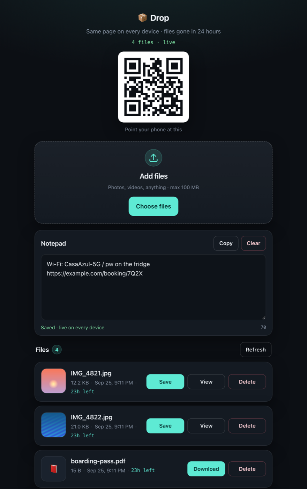

# Drop

A shared inbox for moving files between your own devices. Open the same URL on your laptop and your phone. Upload on one and it appears on the other a few seconds later. Files delete themselves after 24 hours. It runs on Cloudflare Workers, with files in R2 and metadata in D1, and fits in the free tiers.

<p align="center">
  
</p>

No accounts, no per-file links, no framework, no build step. One Worker file, two runtime dependencies.

## Features

- **Shared file list.** Every device sees the same inbox and it refreshes every 3 seconds.
- **Upload from anywhere.** Drag and drop or use the file picker. Large files go up in 10 MB parts, and a dropped part is retried on its own.
- **Phone-friendly saving.** On a phone, **Save to Photos** opens the system share sheet so photos and videos go straight into your camera roll.
- **Previews.** Image and video thumbnails, plus a fullscreen viewer.
- **Containers.** Group files and a notepad together, one container per project or topic. Each container has its own link (`/c/<id>`) and QR code, and deleting a container deletes everything in it. Everything lands in the default **Inbox** until you make more.
- **Shared notepad.** Paste a link, code or address on one device and copy it on the other. It autosaves, syncs live and never expires.
- **QR code.** On desktop the page shows a QR code for its own URL, so you can scan it with your phone to open the same inbox. The code is generated on the server, so the URL is never sent to a third party.
- **Auto-expiry.** Files are deleted after 24 hours by default (configurable).
- **Sign-in.** This deployment (drop.thejonbroadbent.com) sits behind the thejonbroadbent.com single sign-on (`src/sso.js`, secret `SSO_SECRET`; see ATHENS_BRIDGE/JB_SSO). Everything except `/health` needs the `jb_sso` cookie or `Authorization: Bearer <token>`. The `DROP_PASSWORD` option described below has been removed from the code.

## Quick start

Requires Node.js 20 or newer and a Cloudflare account with R2 enabled (it's free up to 10 GB, but you have to switch it on once in the dashboard).

```bash
git clone https://github.com/therealjohnnyb7/OPEN_FILE_DROP.git
cd OPEN_FILE_DROP
npm install
npm run dev       # local Worker with simulated R2 and D1 at http://localhost:8787
```

To use it from your phone on the same Wi-Fi, run `npx wrangler dev --ip 0.0.0.0` and open the desktop browser at your computer's LAN address (for example `http://192.168.1.20:8787`) rather than `localhost`. The QR code encodes whatever address the page was opened on.

## Deploy

```bash
npx wrangler login
npx wrangler secret put DROP_PASSWORD   # strongly recommended
npm run deploy
```

On the first deploy Wrangler creates the R2 bucket (`drop-files`) and the D1 database (`drop-meta`). The Worker creates its tables on first request, so there's no migration step. The site is served at `https://drop.<your-subdomain>.workers.dev`. Add a custom domain in the dashboard if you want one.

A cron trigger runs every 15 minutes to delete expired files, abort unfinished uploads and remove orphaned blobs.

## Configuration

Settings are Worker variables in [`wrangler.jsonc`](wrangler.jsonc). Set the password as a secret so it never lands in the repo.

| Variable | Default | Description |
|---|---|---|
| `DROP_PASSWORD` | *(unset)* | A Worker secret. When set, every page and API route except `/health` requires this password (HTTP Basic auth, and any username works). |
| `MAX_FILE_BYTES` | `2147483648` (2 GB) | Maximum size per file. Large files upload in parts, so this isn't bound by Cloudflare's 100 MB request limit. Phones hold a file in memory for **Save to Photos**, so very large videos may fail to save on older phones. |
| `TTL_HOURS` | `24` | How long files live before they're deleted. |
| `MAX_NOTE_CHARS` | `20000` | Maximum notepad length (hard cap 50,000). |

## Security model

Read this before you put Drop on the internet.

- **Without `DROP_PASSWORD`, the URL is the only protection.** Anyone who has it can list, download, upload and delete files and read the notepad. Hosting platforms often give out short, guessable subdomains, so set a password for any deployment that's reachable from the public internet.
- **The password is one shared secret.** There are no user accounts. Everyone who knows the password sees the same inbox. Only serve it over HTTPS, because Basic auth sends the password with every request. Login attempts aren't rate-limited, so use a long random password.
- **Uploaded files can't run code on the site.** Every file is served with `X-Content-Type-Options: nosniff` and a sandboxing `Content-Security-Policy`. Only images, video and audio are ever served inline. Everything else is forced to download.
- **There's no storage quota.** Anyone who can reach the app can upload, and R2 bills past its free 10 GB. Files expire, but set a password.
- **Files sit in your R2 bucket** until they expire. The notepad never expires. Clear it yourself.

## How it works

- `src/worker.js` is the whole backend. Blobs go to R2 under random keys. Files, containers and notepads are rows in D1.
- Files up to 20 MB are a single streamed `PUT`. Bigger files use an R2 multipart upload in 10 MB parts, three at a time, so no request hits the Workers body limit.
- Expired files are removed on every list or read, and by the 15-minute cron sweep.
- `public/` is plain HTML, CSS and JavaScript, served as Worker static assets. Clients poll `/api/files` every 3 seconds while the tab is visible.
- File responses support HTTP range requests, which iOS Safari needs to play video.

## API

| Method | Path | Description |
|---|---|---|
| `GET` | `/api/files?c=<id>` | One container's active files and notepad, the container list, and server limits. |
| `PUT` | `/api/upload?c=<id>&name=<name>` | Raw file body, streamed straight to R2. Needs `Content-Length`. |
| `POST` | `/api/upload?c=<id>` | Multipart form upload. Field name `file`, 1–10 files. Buffered in memory, so keep it to small files. |
| `POST` | `/api/uploads?c=<id>` | Start a chunked upload. Body `{ "name", "size", "type" }`. Returns `{ id, partSize, partCount }`. |
| `PUT` | `/api/uploads/:id/:part` | Upload part `1..partCount`. Returns `{ partNumber, etag }`. |
| `POST` | `/api/uploads/:id/complete` | Body `{ "parts": [{ "partNumber", "etag" }] }`. Returns the file. |
| `DELETE` | `/api/uploads/:id` | Abort a chunked upload. |
| `GET` | `/api/file/:id` | Metadata for one file. |
| `GET` | `/api/raw/:id` | File content, inline for media and as a download otherwise. |
| `GET` | `/api/download/:id` | File content as a download. |
| `DELETE` | `/api/file/:id` | Delete a file. |
| `GET` | `/api/note?c=<id>` | `{ text, updatedAt, maxChars }` |
| `PUT` | `/api/note?c=<id>` | Body `{ "text": "..." }` replaces the container's notepad. |
| `GET` | `/api/containers` | Containers with file counts. |
| `POST` | `/api/containers` | Body `{ "name": "..." }` creates a container. |
| `PATCH` | `/api/containers/:id` | Body `{ "name": "..." }` renames a container. |
| `DELETE` | `/api/containers/:id` | Deletes a container with its files and notepad. The default container can't be deleted. |
| `GET` | `/qr.svg?c=<id>` | QR code for a container's link on the current origin. |

| `GET` | `/health` | Liveness check. Never password-protected. |

`c` is optional everywhere and defaults to `main`, the Inbox, so older scripts keep working.

Upload from a script:

```bash
curl -u :$DROP_PASSWORD -T photo.jpg "https://your-drop.example.com/api/upload?name=photo.jpg"

# multipart form also works for small files
curl -u :$DROP_PASSWORD -F "file=@photo.jpg" https://your-drop.example.com/api/upload

# into a specific container
curl -u :$DROP_PASSWORD -F "file=@photo.jpg" "https://your-drop.example.com/api/upload?c=<id>"
```

## Development

```bash
npm run dev   # wrangler dev, reloads on change; local R2/D1 state lives in .wrangler/
```

Issues and pull requests are welcome. The goal is to stay small and dependency-light, so please open an issue before starting on anything large.

## License

[MIT](LICENSE)
